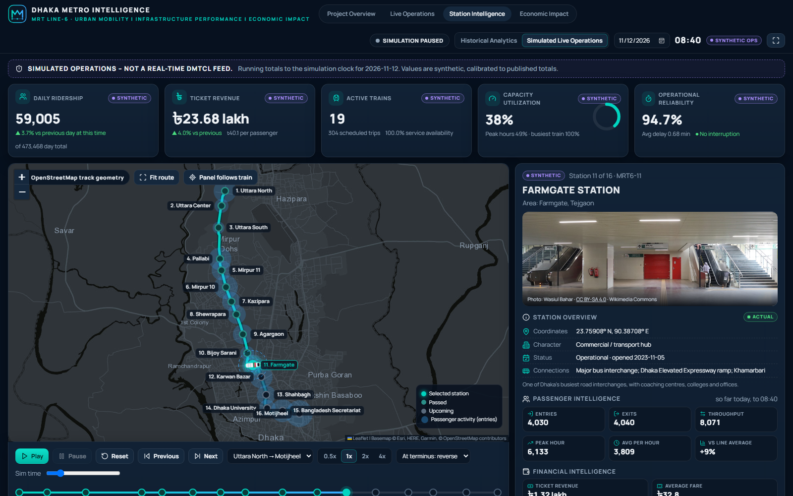
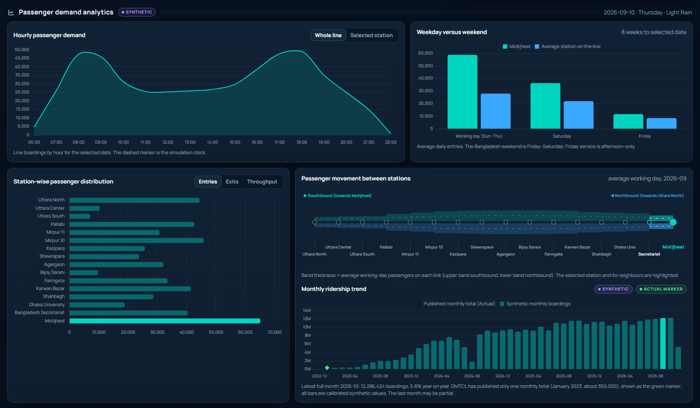
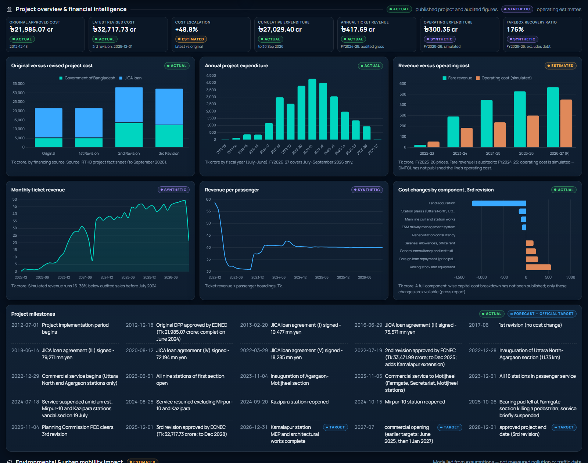
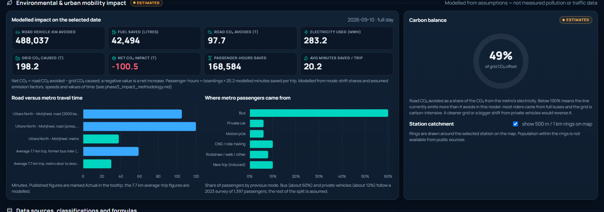
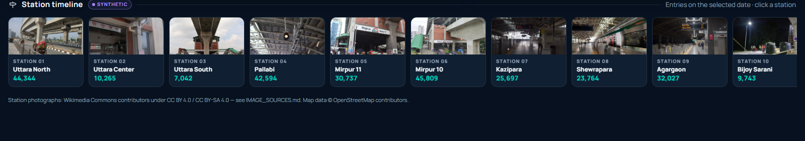

# Dhaka Metro Intelligence — MRT Line-6

An animated web dashboard for Dhaka's first metro line: a train travelling the real track from Uttara North to Motijheel, a station intelligence panel, passenger demand analytics, project finance, and a modelled environmental and economic impact view.

**Live dashboard: https://junayedparves.github.io/dhaka-metro-intelligence/**



> **Read this first.** This is an independent analysis project. It is not affiliated with DMTCL, JICA or the Government of Bangladesh, and it is not a live feed.
> Project cost, yearly spending, loan and audited revenue figures are **published facts**. Daily, hourly, station, train, revenue and energy figures are **simulations** calibrated to published totals, because DMTCL does not publish operating data. Impact figures are **modelled estimates**. Every block on screen carries an Actual, Synthetic, Estimated or Forecast badge.

## The story this dashboard tells

MRT Line-6 has succeeded as a transport service and has yet to prove itself as an investment.

- **People use it.** Ridership grew from 3,857 on the first day in December 2022 to a record 499,756 on 10 September 2026, which is the line's design level. Cumulative ridership reached 313.5 million by August 2026.
- **It cost more and took longer than approved.** The approved cost rose from Tk 21,985 crore to Tk 32,718 crore (+48.8%), and the project end date moved from June 2024 to December 2028. The government's own share rose 132%.
- **Fares appear to cover running costs, not the debt.** Audited ticket sales reached Tk 418 crore in FY2024-25. Estimated loan repayments rise to about Tk 1,000 crore a year by 2030.
- **Passengers save real time.** A modelled 20 minutes per trip on average, and about 29 minutes for a former bus rider.
- **The climate benefit is not there yet.** In this model the line emits more CO₂ than it avoids, because about 60% of riders came from full buses and the electricity grid is carbon-intensive.
- **The economic case is unproven on public evidence.** On direct passenger benefits the modelled return is far below what the original appraisals expected, mainly because trips are shorter than planned (about 7.7 km on a 20 km line).

The dashboard lets you watch where demand concentrates along the corridor, compare stations, replay any day since opening, and see which numbers are facts and which are simulations. The full written assessment is in [docs/Final_Report_Dhaka_Metro_Rail.md](docs/Final_Report_Dhaka_Metro_Rail.md).

## What is in the dashboard

| Section | What it shows |
|---|---|
| KPI strip | Daily ridership, ticket revenue, active trains, capacity utilization, reliability |
| Animated map | A train moving along the real Line-6 track, stopping at all 16 stations, with a route trail and passenger-activity bubbles |
| Station intelligence | Photo, coordinates, entries, exits, peak hour, revenue, average fare, train arrivals, waiting time and surroundings for the selected station |
| Journey controls | Play, pause, reset, previous, next, direction, speed, a clickable 16-station progress bar, and what to do at the terminus |
| Demand analytics | Hourly demand, weekday versus weekend, station distribution, passenger flow between stations, monthly trend |
| Financial intelligence | Cost revisions, yearly spending, revenue versus operating cost, monthly revenue, revenue per passenger, cost changes by component, milestones |
| Environmental and urban mobility | Vehicle-km and fuel avoided, CO₂ balance, travel-time comparison, where passengers came from, station catchment rings |
| Data sources | Dataset status, CSV import, classification legend, metric definitions |
| Station timeline | All 16 stations with thumbnails and passenger counts |

### Screenshots

**Passenger demand analytics**



**Project overview and financial intelligence**



**Environmental and urban mobility impact**



**Station timeline**



The whole page in one image: [docs/screenshots/02_full_dashboard.png](docs/screenshots/02_full_dashboard.png).

## How it was built

The dashboard is the last step of a five-stage project. Each stage is documented in [docs/methodology](docs/methodology).

1. **Historical project research.** Cost revisions, yearly allocation and spending, loan agreements, milestones, published ridership and audited revenue were collected from government, JICA and audited documents, with press sources used to cross-check. Every figure carries a source ID and a confidence rating. 59 sources are registered in [source_register_consolidated.csv](docs/methodology/source_register_consolidated.csv).
2. **Synthetic operations.** Because no daily, station or train data is published, seven datasets were simulated from a fixed random seed: station entries and exits by day and hour, ticket revenue, train runs, energy, incidents and operating expenses. The simulation is calibrated to the published figures: cumulative ridership matches the published 313,546,306 exactly, nine published single-day totals are reproduced, and FY2024-25 revenue lands within 3.4% of the audited figure. See [phase2_synthetic_methodology.md](docs/methodology/phase2_synthetic_methodology.md).
3. **Impact modelling.** Travel-time savings, vehicle operating cost savings, emissions and a cost-benefit analysis across nine scenarios, with every assumption listed. See [phase3_impact_methodology.md](docs/methodology/phase3_impact_methodology.md).
4. **Analytical database.** A 29-table star schema with validated keys, a data dictionary and a data quality report. See [data_quality_report.md](docs/methodology/data_quality_report.md).
5. **This dashboard.** A single HTML file that reads a compact data file built from the stages above.

### Geography and photographs

- **Track and stations** come from OpenStreetMap relation 15060935 ("Dhaka Metro Rail Line 6"): 241 track vertices and the 16 station stop positions. Nothing is hand-placed.
- **Station photographs** are from Wikimedia Commons, one per station, each taken from that station's own Commons category and used under CC BY 4.0 or CC BY-SA 4.0. Authors and licences are in [IMAGE_SOURCES.md](IMAGE_SOURCES.md).

### Technology

| Part | Tool |
|---|---|
| Page | HTML5, CSS3, vanilla JavaScript in one `index.html` |
| Map | Leaflet 1.9.4 with Esri World Dark Gray tiles |
| Charts | Chart.js 4.4.1; the passenger-flow diagram is hand-built SVG |
| Motion | `requestAnimationFrame` for the train, GSAP 3.12.5 for small transitions |
| Icons and type | Lucide icons, Manrope |
| Data preparation | Python, standard library only ([tools/](tools)) |

There is no backend and no build step. One shared state object holds the mode, date, clock, train position, direction, speed and selected station; the train, panel, KPIs, charts and timeline all read from it. No random numbers are generated at render time.

## Using it

- **Modes.** *Simulated Live Operations* runs a simulation clock and shows running totals up to it. *Historical Analytics* shows full-day values. Neither is real time.
- **Date.** Any day from 29 December 2022 to 13 November 2026, including closed days.
- **Stations.** Click a station on the map, timeline, bar chart or flow diagram to pin the panel to it; the train keeps moving. *Resume following train* hands the panel back to arrivals.
- **Keyboard.** Space toggles play; the arrow keys step between stations.
- **Reduced motion.** The page respects the operating system's reduced-motion setting.

### Shareable links

Add options to the address to open a specific view:

| Option | Example | Effect |
|---|---|---|
| `date` | `?date=2026-09-10` | Selects that day |
| `mode` | `?mode=hist` | Historical Analytics (`sim` is the default) |
| `station` | `?station=11` | Places the train at that station (1–16) |
| `time` | `?time=08:40` | Sets the simulation clock |
| `play` | `?play=0` | Starts paused |

Example: the record day at Motijheel — https://junayedparves.github.io/dhaka-metro-intelligence/?date=2026-09-10&mode=hist&station=16&play=0

## Running it locally

Open `index.html` in a modern browser, or serve the folder:

```bash
python -m http.server 8765
```

Then open `http://localhost:8765`. An internet connection is needed for the map tiles, fonts and the four CDN libraries.

## Updating the data

1. **In the browser.** Under *Data sources*, choose *Import CSV files* and select any of the eleven named datasets. Files are matched by name, checked for required fields, aggregated and applied. Nothing is uploaded anywhere. Small test files are in [sample_data/csv](sample_data/csv). Required fields are in [data_dictionary.md](data_dictionary.md).
2. **Rebuild the packaged file.** The scripts in [tools/](tools) generated the data. They expect the full analytical package (about 200 MB of CSVs), which is not in this repository, so they are included for reference and audit.

If `sample_data/dashboard_data.js` is missing, the page builds a small demonstration dataset from a fixed seed and labels everything *Demonstration*.

## Repository layout

| Path | Contents |
|---|---|
| `index.html` | The application |
| `sample_data/` | Packaged data (`dashboard_data.js`, `.json`), CSV extracts, the OpenStreetMap relation |
| `assets/` | Station photographs, photo credits, train illustration |
| `docs/screenshots/` | Images used in this README |
| `docs/methodology/` | Methodology notes, data quality report, source and assumption registers |
| `docs/Final_Report_Dhaka_Metro_Rail.md` | The written assessment |
| `tools/` | Python scripts that produced the datasets and the dashboard data file |
| `data_dictionary.md` | Fields the dashboard reads |
| `IMAGE_SOURCES.md` | Image, map and library credits |

## Metric definitions

| Metric | Definition |
|---|---|
| Daily ridership | Sum of station entries. Entries and exits are never added together for this. |
| Station throughput | Entries + exits |
| Capacity utilization | Load on a train's busiest section ÷ 2,300 × 100 |
| Revenue per passenger | Ticket revenue ÷ boardings |
| Farebox recovery ratio | Fare revenue ÷ operating expenses × 100 |
| Travel-time saving | Baseline road time − metro door-to-door time |
| Net CO₂ impact | Road CO₂ avoided − CO₂ from metro electricity |
| Simulated-live values | Day total × share of the day's hourly demand elapsed at the clock |

## Limitations

- More than 99% of the underlying records are simulated. They reproduce plausible patterns and published totals; they cannot reveal anything about real operations that was not put into them.
- The true operating cost of the line is not public, so the farebox ratio is indicative.
- Impact and cost-benefit figures depend on assumptions about values of time, road speeds and emission factors that could not be verified.
- Station hour-by-hour figures use an average profile per day type.
- Descriptions of nearby places are written context, not a dataset. Catchment population is not available.
- A full component-wise capital cost breakdown has not been published, so that chart shows only the changes in the third revision.
- Research used public sources only, with a cut-off of 13 November 2026.

## Credits and licences

- **Code and documentation** (the dashboard, scripts, written documents, logo and train illustration): [MIT License](LICENSE).
- **Not covered by the MIT License:** station photographs, map data and tiles, and third-party libraries keep their own licences, listed below and in [IMAGE_SOURCES.md](IMAGE_SOURCES.md).
- Map data © OpenStreetMap contributors (ODbL). Basemap tiles © Esri, HERE, Garmin.
- Station photographs © their Wikimedia Commons authors, CC BY 4.0 / CC BY-SA 4.0 — see [IMAGE_SOURCES.md](IMAGE_SOURCES.md).
- Libraries: Leaflet, Chart.js, GSAP, Lucide. Typeface: Manrope.
- The logo and train illustration were drawn for this project and are not official DMTCL marks.
